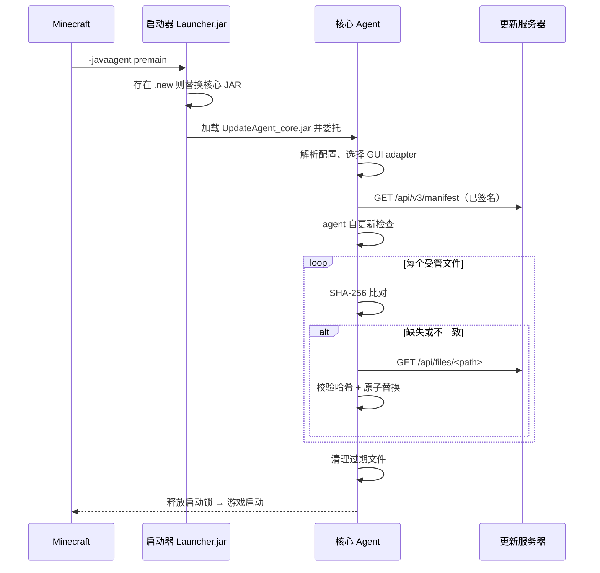

# Minecraft 自动更新服务

> 通过自托管 HTTP API 与 Java Agent，在多台机器间保持 Minecraft 客户端资源同步更新。

- [English](README.md)
- [GUI Adapter API](GUI_ADAPTER_API.md)
- [GUI Adapter API 中文说明](GUI_ADAPTER_API_CN.md) — 开发自定义 GUI 预设。

## 文档索引

| 文件 | 面向对象 | 作用 |
|------|----------|------|
| `README.md` / `README_CN.md` | 运维人员与维护者 | 构建、部署、配置与多平台预设发布。 |
| `GUI_ADAPTER_API.md` / `GUI_ADAPTER_API_CN.md` | GUI 开发者 | 对外 GUI 契约、预设协议与元数据、V1/V2 adapter 开发。 |

## 简介

| 组件 | 职责 |
|------|------|
| **服务端** (Python/Flask, Docker) | 托管文件清单与资源下载的 REST API。 |
| **Agent** (Java, `-javaagent`) | Minecraft 启动时加载 — 检查更新、显示 GUI 进度、同步文件，完成后启动游戏。 |

### 双 JAR 设计（安全自更新）

| JAR | 职责 |
|-----|------|
| `UpdateAgent.jar`（启动器） | 由 `-javaagent` 加载的薄封装层。启动时若存在 `.jar.new` 则替换核心 JAR，然后委托给核心逻辑。**永不更新**，避免了 Windows 平台的文件锁问题。 |
| `UpdateAgent_core.jar`（核心） | 实际的更新逻辑：HTTP 同步、GUI、文件清理。**可自更新** — 新版本下载为 `.jar.new`，下次启动时替换。 |

### 启动流程



### Agent 源码分层

核心 Agent 以小型分层组织（全部位于 `com.zack88604.autoupdater`）：

| 包 | 职责 |
|----|------|
| `application` | `UpdateController`（生命周期）、`UpdateService`（业务流程）、事件、状态归约与限频状态渲染。 |
| `domain` | `Manifest`、`FileEntry`、`UpdateResult`、`AgentArtifact`。 |
| `infrastructure` | `FileManager`、`ServerClient`、JSON 解析。 |
| `gui.api` | 与工具包无关的 GUI 契约与 Java helper 协议 API。 |
| `gui.swing` | 内建 Swing adapter 与受信任的预设选择器。 |
| `gui.preset` | V1 进程内与 V2 隔离 helper 预设的发现、校验与加载。 |
| `bootstrap` / `config` | Agent 入口组装与配置优先级解析。 |

## 快速开始

### 服务端

```bash
# 在仓库根目录先构建 agent
bash agent/build.sh

# 创建持久化服务端数据，并放入当前 core JAR
mkdir -p /srv/mc-update/files /srv/mc-update/agent /srv/mc-update/gui-presets
cp agent/UpdateAgent_core.jar /srv/mc-update/agent/

# 在仓库根目录构建并启动服务端
docker build -t mc-update-service .
docker run -d -p 25565:25565 \
  -v /srv/mc-update:/data \
  --name mc-update mc-update-service

# 修改文件或 update-config.json 后重新生成清单
docker exec mc-update python3 /app/generate_manifest.py \
  --dir /data/files --out /data --agent-jar /data/agent/UpdateAgent_core.jar
```

### Agent

```bash
# Linux/macOS（需要 JDK 17 或更高版本）
bash agent/build.sh
bash agent/setup-agent.sh ~/.minecraft/versions/1.20.1 http://your-server:25565 BASE64_X509_ED25519_PUBLIC_KEY

# Windows
agent\build.bat
agent\setup-agent.bat C:\path\to\instance http://your-server:25565 BASE64_X509_ED25519_PUBLIC_KEY
```

安装脚本会将服务器配置写入游戏目录下的 `mc-update.properties`，并向启动器 JVM 参数追加 `-javaagent:<path>/UpdateAgent.jar`。

更新器拥有的运行时文件：

```text
<game-dir>/
├── mc-update.properties                 # 持久化 server/debug/adapter 设置
└── .mc-update/
    ├── gui-selection.properties          # 可选的已记住 GUI 选择
    ├── gui-server-trust.properties       # 已批准的服务器 URL 与预设身份
    ├── gui-presets/                      # 本地及服务端下载的预设 JAR
    └── gui-runtimes/                     # 已校验的 V2 helper 运行时解压目录
```

## 签名清单配置

服务端首次签名清单时，会在 `/data/manifest-keys/` 生成持久化 Ed25519 签名密钥，私钥不会通过 API 提供。管理员应通过可信渠道把 `/data/manifest-keys/manifest-signing-public.der.base64` 复制到每个客户端，并固定到 `mc-update.properties`：

```properties
server=http://your-server:25565
manifest-public-key=BASE64_X509_ED25519_PUBLIC_KEY
# 可选：manifest-key-id=ed25519-0123456789abcdef
```

未配置公钥时，客户端会一次性显示服务器地址、key ID 与 SHA-256 指纹供用户确认；同意后会固定该密钥，之后绝不自动替换。客户端从 `/api/v3/manifest` 获取清单，在改动任何文件前验证 Ed25519 签名、有效期和内嵌清单哈希。当前核心以 Java 17 为目标构建，运行及构建均要求 Java 17 或更高版本。`/api/v3/manifest-public-key` 仅用于管理员检查，客户端绝不自动信任它。`/api/v2/manifest` 保留给旧客户端。

## 安全跳过更新

资源下载连续约 5 秒没有新数据时，核心通过状态事件提示正在等待网络。
默认允许连续 3 次无明显进展的失败；多源的此项额度至少覆盖全部配置源，并按配置顺序切换。一次下载尝试中，当前文件实际字节进度比尝试开始前的历史最高进度再推进至少配置的百分比（默认 1%）时，连续无进展计数清零；重传已有字节或完整性校验失败不算进展。
网络失败后优先按本次运行的临时文件长度续传，检查 `Content-Range`，有强 ETag 时发送 `If-Range`。
服务器返回完整响应时重新下载并重置进度；大小或 SHA-256 不符时丢弃错误内容后重试。
重试耗尽后立即停止当前更新，保留失败文件进度，不再下载后续文件、清理旧文件或写入可信清单缓存。
失败界面提供“回退到可信版本”“重试更新”和“退出”。手动重试会重新获取清单，保留已完成的改动并跳过仍符合校验值的文件；连续重试共用首次更新前的回滚备份，直到成功、回退或退出。
连接/文件读取超时默认为 10/60 秒，清单读取超时默认为 30 秒，均可在 `mc-update.properties` 中配置；续传暂不跨进程重启保留。

完整更新成功后，更新器会逐项校验本地资源，并以原子方式缓存已经通过 Ed25519 验证的 v3 清单信封到 `.mc-update/signed-manifest-cache.properties`。用户确认跳过进行中的更新时，更新器会先还原本次更新，再校验缓存的 Ed25519 签名、有效期、服务器身份、清单哈希，以及每个列出资源的 SHA-256 与大小。缓存被人为修改、过期，或任意资源不一致时，Minecraft 都不会启动。

## 服务端维护模式

在 `/data/update-config.json` 中增加以下字段，保留原有配置：

```json
"maintenance": {
  "enabled": true,
  "message": "服务器正在维护，预计今晚 22:00 恢复。\n请稍后重试。"
}
```

默认关闭。配置在每次清单请求时读取；设为 `false` 后无需重启服务或重新生成清单。
`enabled` 必须是布尔值；`message` 支持中文、换行和引号，最多 4096 个字符，缺省或空白时使用默认提示。
建议以完整文件原子替换配置，避免写入中途的无效 JSON。

维护只阻断 `/api/v2/manifest` 和 `/api/v3/manifest`，返回 HTTP 503 和
`{"code":"MAINTENANCE","message":"…"}`，禁止缓存。资源、agent、GUI 预设下载及健康检查继续开放。
客户端只在首次更新及失败后的手动重试获取清单时检查维护；已经开始的一整轮更新，包括剩余文件、自动重试、断点续传和自动切换服务器，都可以继续完成。

客户端跳过维护服务器，按配置顺序尝试其他源。只有全部配置服务器都明确返回维护时才进入维护状态，显示配置列表中第一台服务器的消息。
部分维护、部分超时/断网/普通 HTTP 错误按普通失败处理，不能认定为全部维护。

维护弹窗仅提供“可信版本启动”和“退出”。前者还原本次更新的修改并验证缓存签名、有效期、服务器身份及本地资源，成功后才启动 Minecraft；没有有效可信缓存时不能启动。
后者复用普通失败退出流程，保留已完成的修改，不回滚，也不启动 Minecraft。关闭维护弹窗同样按退出处理。
旧客户端可被清单接口阻断，但不支持此专用提示；应先发布新版核心和预设，再开启维护。

## API

| 端点 | 方法 | 描述 |
|------|------|------|
| `/api/v2/manifest` | GET | 完整文件清单（路径、SHA-256、大小） |
| `/api/v3/manifest` | GET | 供固定公钥客户端使用的 Ed25519 签名清单信封 |
| `/api/v3/manifest-public-key` | GET | 供管理员固定公钥的公开密钥描述 |
| `/api/files/<path>` | GET | 下载指定资源文件 |
| `/api/agent` | GET | 下载最新 `UpdateAgent_core.jar` |
| `/api/v2/gui-preset` | GET | 兼容旧客户端的可选单包 GUI 预设描述 |
| `/api/v3/gui-preset` | GET | GUI 预设多平台清单，由客户端按 JVM 环境选择变体 |
| `/api/v2/gui-presets/<archive>.jar` | GET | 描述文件指定的预设 JAR |
| `/api/config` | GET | 管理路径与排除路径配置 |
| `/api/generate` | POST | 生成已配置的服务端目标（Token 保护） |
| `/api/health` | GET | 健康检查 |

## GUI Adapter 开发

更新器通过一个与工具包无关的 GUI 边界渲染界面。内建 Swing adapter 是默认实现；
自定义工具包**无需改动更新逻辑与生命周期控制**即可接入，有两种方式：

| 方式 | 做法 | 适用场景 |
|------|------|----------|
| **编译进核心 + 属性** | 把工厂编译进核心 JAR，配置 `mc-update.gui-adapter=<类名>` | 你维护/重新构建 agent |
| **外部预设** | 把 V1 adapter JAR 或 V2 Java-helper JAR 放进 `.mc-update/gui-presets/`，首次启动时选择 | 独立分发 GUI，无需重构建 agent |

完整教程与 API 参考见 [GUI Adapter API](GUI_ADAPTER_API_CN.md)。

## 配置

### 服务端（环境变量）

| 变量 | 默认值 | 描述 |
|------|--------|------|
| `PORT` | `25565` | HTTP 端口 |
| `GENERATE_TOKEN` | *（空）* | 保护 `/api/generate` 接口 |
| `MANIFEST_SIGNATURE_TTL_SECONDS` | `604800` | 签名清单有效期（1 秒–31 天） |
| `DEBUG` | `false` | Flask 调试模式 |

### Agent（JVM 属性）

配置优先级（普通模式）如下：

1. 游戏目录下的 `mc-update.properties` *（由安装脚本写入）*
2. 内联 `-javaagent` 参数
3. `-D` 系统属性
4. 内置默认值

（内联参数加 `admin=true` 时反转：参数 → 系统属性 → 配置文件。）

| 属性 | 默认值 | 描述 |
|------|--------|------|
| `mc-update.server` | `http://localhost:25565` | 服务器地址 — 支持**逗号分隔多源**，自动故障转移 |
| `mc-update.game-dir` | `.` | Minecraft 目录 |
| `mc-update.debug` | `false` | 同步完成后保持窗口打开 |
| `mc-update.gui-adapter` | *（内建 Swing）* | `GuiAdapterFactory` 的完整类名 |
| `mc-update.server-gui` | `disabled` | 服务端预设策略：`disabled`、`recommended` 或 `required` |
| `mc-update.manifest-public-key` | *（必填）* | 管理员固定的 Base64 X.509 Ed25519 公钥 |
| `mc-update.manifest-key-id` | *（可选）* | 期望的 `ed25519-…` 密钥标识 |
| `mc-update.max-no-progress-failures` | `3` | 单个文件连续无进展失败额度；实际额度至少等于服务器数量（1–1000） |
| `mc-update.connect-timeout-seconds` | `10` | 主更新连接超时秒数（1–3600） |
| `mc-update.manifest-read-timeout-seconds` | `30` | 清单读取等待超时秒数（1–3600） |
| `mc-update.download-read-timeout-seconds` | `60` | 文件读取等待超时秒数（1–3600） |
| `mc-update.progress-reset-threshold-percent` | `1` | 单次尝试中新字节超过历史最高进度的百分比达到此值时，清零无进展失败计数（1–100） |

**推荐方式：`mc-update.properties`**（由安装脚本写入）：
```properties
server=http://cdn1.example.com:25565,http://cdn2.example.com:8443
max-no-progress-failures=3
connect-timeout-seconds=10
manifest-read-timeout-seconds=30
download-read-timeout-seconds=60
progress-reset-threshold-percent=1
```

**内联 agent 参数**：
```
-javaagent:UpdateAgent.jar=server=http://1.2.3.4:25565,game-dir=C:\mc,debug=true
```

**多源故障转移**（某源不可用时自动切换）：
```
-javaagent:UpdateAgent.jar=server=http://cdn1.example.com:25565,http://cdn2.example.com:8443
```

**管理员模式**（`admin=true`）— 适用于一次性覆盖，内联值优先：
```
-javaagent:UpdateAgent.jar=admin=true,server=http://override:25565
```

### 服务端发布 GUI 预设

服务器可以在普通游戏文件清单之外发布一个可选 GUI 预设，并为它提供不同的平台包。
客户端根据启动 Minecraft 所用 JVM 的操作系统、架构和 Java 版本选择兼容包。
核心需要 Java 17+，并且必须达到所选预设的最低 Java 版本要求。

#### 平台与发布配置

| 平台标识 | JVM 环境 | 示例文件名后缀 |
|----------|----------|----------------|
| `windows-x64` | Windows x64 | `win.jar` |
| `linux-x64` | Linux x64 | `linux.jar` |
| `macos-x64` | macOS x64 | `mac.jar` |
| `macos-arm64` | macOS ARM64 | `mac-aarch64.jar` |

`amd64` / `x86_64` / `x64` 归一化为 x64，`aarch64` / `arm64` 归一化为 ARM64。
Apple Silicon 上使用 x64 Java 时选择 macOS x64 包。没有兼容变体、未知系统或 32 位
JVM 均使用内建 Swing，普通资源更新流程继续执行。

将准备发布的 JAR 手动上传到 `/srv/mc-update/gui-presets/`，然后在现有
`/srv/mc-update/update-config.json` 中合并 `generation` 配置，保留其他同步及维护设置：

```json
{
  "managed_paths": ["mods/", "config/", "resourcepacks/"],
  "excluded_paths": ["config/secret.cfg"],
  "generation": {
    "targets": ["manifest", "gui-preset"],
    "gui_preset": {
      "id": "example-javafx",
      "version": "1.0.0",
      "file": "example-javafx-1.0.0-win.jar",
      "variants": {
        "windows-x64": "example-javafx-1.0.0-win.jar",
        "linux-x64": "example-javafx-1.0.0-linux.jar",
        "macos-x64": "example-javafx-1.0.0-mac.jar",
        "macos-arm64": "example-javafx-1.0.0-mac-aarch64.jar"
      }
    }
  }
}
```

- `variants` 是平台标识到文件名的映射，允许只配置 `windows-x64`；此时只需上传 Windows 包。
  所有已声明的文件都必须存在，映射不允许为空或 `null`。
- `file` 是可选的旧客户端单包入口。不需要旧客户端兼容时可以省略；只配置 `file` 则维持
  单包发布行为。v3 清单缺少当前平台时，客户端不会从同一服务器的 v2 入口下载其他平台包。
- 每个变体必须包含与配置相符的平台元数据和版本号，最低 Java 版本从包内运行时清单读取。
  字段定义见 [GUI API：预设元数据](GUI_ADAPTER_API_CN.md#71-预设元数据)。
- 这里使用通用示例文件名。使用 [FireflyTornado JavaFX UI Preset](https://github.com/FireflyTornado/UI-preset-for-Zack88604-Minecraft-server-updater)
  等具体预设时，按其 README 构建，并填写实际文件名及版本号。

#### 生成与验证

配置了 `GENERATE_TOKEN` 时，发布请求携带现有 Token：

```bash
curl -fsS -X POST https://update.example.com/api/generate \
  -H "X-Generate-Token: $GENERATE_TOKEN"
```

`/api/generate` 只读取服务端配置，不上传代码。所有已声明文件验证成功后，服务端计算
SHA-256 和大小，并原子替换 `/srv/mc-update/gui-preset.json`；任意声明无效或文件缺失时，
预设发布失败，上一份预设清单保持不变。没有 `generation` 节点时，默认只生成 `["manifest"]`。
`/api/config` 只返回 `managed_paths` 和 `excluded_paths`，不会暴露 `generation`。

发布后检查多平台清单；配置了 `file` 时，也可检查旧单包入口：

```bash
curl -fsS https://update.example.com/api/v3/gui-preset
curl -fsS https://update.example.com/api/v2/gui-preset
```

清单描述格式见 [GUI API：服务端发布的预设](GUI_ADAPTER_API_CN.md#服务端发布的预设)。

#### 客户端策略与兼容性

在游戏目录的 `mc-update.properties` 中启用：

```properties
server-gui=recommended
```

`disabled`（默认）不查询服务端预设；`recommended` 尊重已记住的本地选择，并刷新已选中的
服务器预设；`required` 优先使用服务器预设。显式配置的 `gui-adapter` 始终优先。
首次加载每个 `服务器 URL + 预设 id` 身份都需要用户批准，版本或平台变化不改变该身份。
没有兼容包、下载校验失败或 helper 启动失败时回退 Swing，自动回退不保存为用户的默认偏好。

| 客户端 / 服务端能力 | 行为 |
|--------------------|------|
| 支持 v3 的客户端 / 多平台发布 | 精确选择兼容变体；没有匹配项则 Swing |
| 支持 v3 的客户端 / 旧服务端或仅配置 `file` | v3 返回 404/405 时尝试 v2 |
| 仅支持 v2 的客户端 / 提供 `file` 的服务端 | 使用指定单包，不进行平台选择 |
| v3 无效、返回 503 或下载失败 | 不向同一服务器的 v2 降级，可尝试其他配置源 |

客户端统一使用 `.mc-update/gui-presets/server-<id>.jar`，版本或 JVM 平台变化时在同一路径
校验并原子替换预设。运行时缓存规则见 [GUI API：运行时清单](GUI_ADAPTER_API_CN.md#72-运行时清单)。

#### 版本发布与 CDN

预设内容变化时使用新的版本号和文件名，并保持原 `id`。先上传所需平台包，再更新配置并
生成清单。首次启用多平台功能时，先准备预设包，再部署支持新旧接口的服务端，最后下发
支持 v3 的核心；已有客户端的核心自更新在下一次启动时生效。

CDN 预热使用清单中 `path` 指向的 `/api/v2/gui-presets/<archive>.jar` 文件地址。
`/api/v3/gui-preset` 和 `/api/v2/gui-preset` 是动态描述接口，应禁止 CDN 缓存。
同名覆盖已缓存文件时需先刷新该文件缓存，再预热并核对 CDN 实际返回的大小和哈希；
否则核心会拒绝不一致的包并回退 Swing。

生产环境应使用 HTTPS。`GENERATE_TOKEN` 只保护发布操作，不保护客户端下载，不应写入
客户端配置。平台包的具体窗口行为仍需在对应系统及 JVM 上实测。

### 选择性同步 (`update-config.json`)

将此文件放在挂载的服务端数据根目录；以上示例对应
`/srv/mc-update/update-config.json`。

```json
{
  "managed_paths": ["mods/", "config/", "resourcepacks/", "options.txt"],
  "excluded_paths": ["config/secret.cfg", "mods/skip_this/"]
}
```

| 写法 | 匹配范围 |
|------|----------|
| `path/`（斜杠结尾） | 该目录下的全部内容（递归） |
| `file.txt`（普通名称） | 仅该精确文件 |
| `*` | 全部（仅可作为整条 `managed_paths` 项） |

`excluded_paths` 优先级高于 `managed_paths` — 被排除的文件既不同步也不清理。
默认值：`managed_paths: ["*"]`，`excluded_paths: []`。

## 项目结构

```text
├── README.md / README_CN.md              # 运维与维护说明
├── GUI_ADAPTER_API.md / GUI_ADAPTER_API_CN.md  # 对外 GUI 扩展契约
├── LICENSE                               # MIT 许可证
├── Dockerfile                            # 服务端镜像，从此根目录构建
├── server/
│   ├── app.py                            # Flask API
│   ├── entrypoint.sh                     # 容器入口
│   ├── generate_manifest.py              # 清单生成器
│   ├── gui_presets.py                    # 单包与多平台 GUI 预设发布校验
│   └── requirements.txt
└── agent/
    ├── META-INF/MANIFEST.MF              # java-agent 启动器清单
    ├── build.sh / build.bat              # 构建两个 JAR
    ├── setup-agent.sh / setup-agent.bat  # 写入游戏目录配置
    └── src/
        ├── Launcher.java                 # 稳定启动器，不自更新
        ├── UpdateAgent.java              # 兼容性 facade
        └── com/zack88604/autoupdater/
            ├── bootstrap/                # 组合根
            ├── config/                   # 配置优先级
            ├── application/              # 更新流程、取消、UI 状态泵
            ├── domain/                   # 清单值对象
            ├── infrastructure/           # 文件、HTTP、JSON
            └── gui/
                ├── api/                  # 对外 GUI 与 helper 契约
                ├── swing/                # 内建回退 GUI
                └── preset/               # V1/V2 外部预设运行时
```

构建产物：
- `agent/UpdateAgent.jar` — 由 `-javaagent` 加载的启动器 JAR
- `agent/UpdateAgent_core.jar` — 可自更新的核心 Agent JAR

## 许可证

MIT
